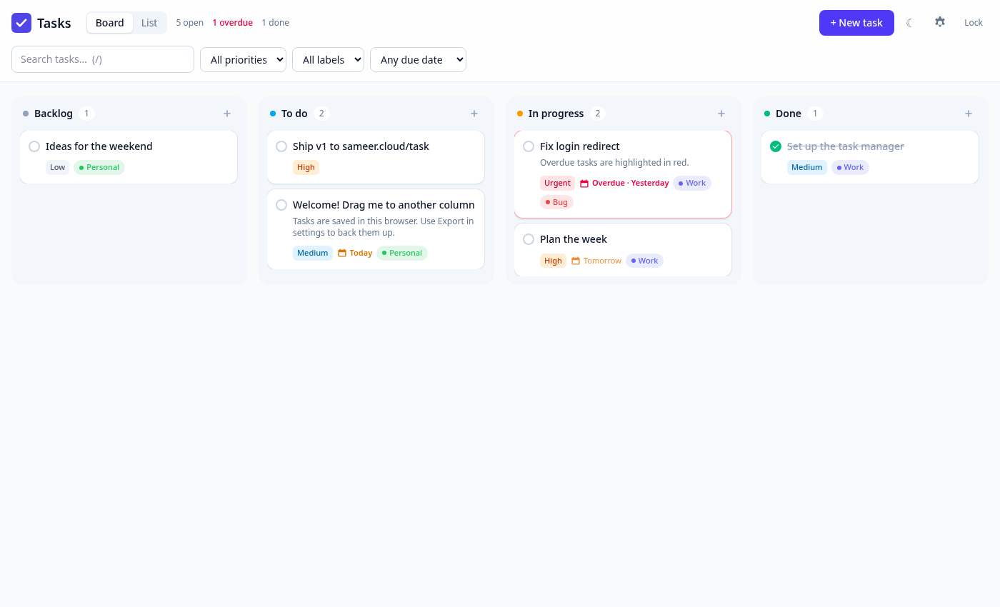
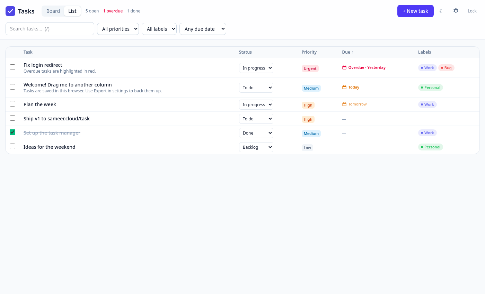
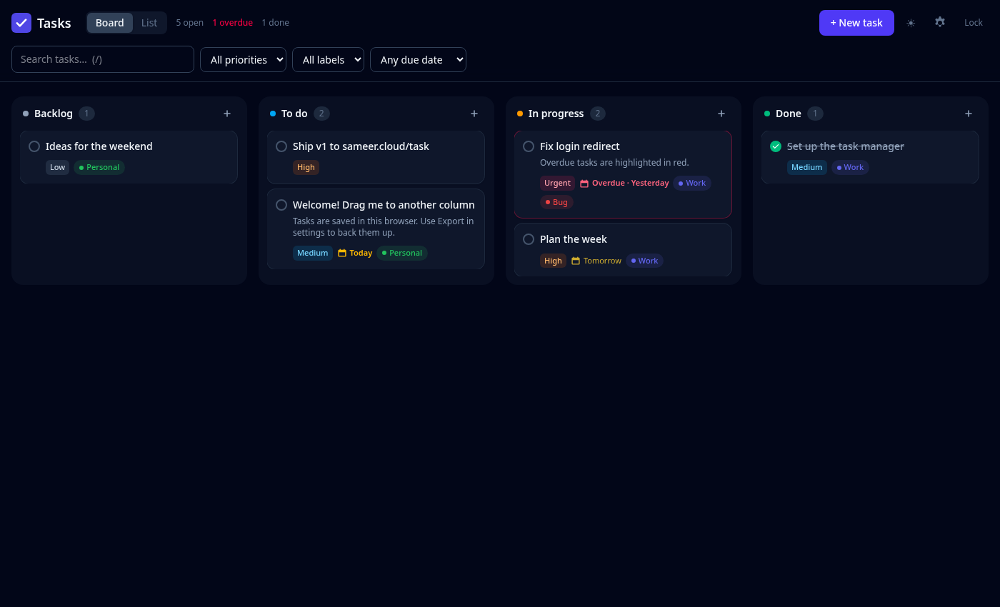

# Tasks — open-source task manager

A clean, fast, self-hostable task manager built as a static single-page app.
Live at **[sameer.cloud/task](https://sameer.cloud/task/)**.



## Features

- **Kanban board** — Backlog → To do → In progress → Done. Drag cards between columns and reorder within a column.
- **List view** — sortable table (due date, priority, status, title) with inline status changes and checkboxes.
- **Due dates** — overdue tasks are highlighted in red; "Today", "Tomorrow" and due-soon hints.
- **Priorities** — Low, Medium, High, Urgent.
- **Labels / tags** — create, rename, recolour and delete; multiple labels per task.
- **Search & filters** — by text, priority, label and due window (overdue, today, this week, none).
- **Simple auth** — single-user password gate (create one on first visit, or bake one in at build time).
- **Local-first** — data is saved in the browser (`localStorage`), syncs across tabs, and can be exported/imported as JSON.
- **Dark mode**, responsive layout, and keyboard shortcuts: `N` new task, `/` search, `B` board, `L` list, `Esc` close.
- No backend, no database, no tracking. ~56 KB gzipped JS.

| List view | Dark mode |
| --- | --- |
|  |  |

## Stack

[Vite](https://vite.dev) · [React 18](https://react.dev) · TypeScript · [Tailwind CSS v4](https://tailwindcss.com). Zero runtime dependencies besides React.

## Local development

Requires Node.js 20+.

```bash
git clone https://github.com/samayhuf-star/sameer-cloud-taskmanager.git
cd sameer-cloud-taskmanager
npm install
npm run dev          # http://localhost:5173/task/
```

## Build

```bash
npm run build        # outputs static files to dist/
npm run preview      # serve dist/ locally
```

The build is configured for the `/task/` subpath (`base` in `vite.config.ts`).
Override it with `BASE_PATH`:

```bash
BASE_PATH=/ npm run build            # serve from a domain root
BASE_PATH=/taskmanager/ npm run build
```

## Authentication

This is a lightweight, single-user gate meant for a personal board:

- **Default:** on first visit you create a password; its SHA-256 hash is stored in that browser.
  Each browser keeps its own tasks and password.
- **Fixed password:** set `VITE_PASSWORD_SHA256` at build time (see `.env.example`):

  ```bash
  npm run hash-password -- "my secret"     # prints the hash
  VITE_PASSWORD_SHA256=<hash> npm run build
  ```

> Because everything runs and is stored in the browser, the gate protects the UI on a shared
> device; it is not server-side access control. For a hard lock on a public server, add HTTP basic
> auth in front of `/task/` (example below).

## Deploying at a subpath (e.g. `https://sameer.cloud/task`)

The app is plain static files, so any web server works.

### nginx (recommended)

1. Build and copy the files to the server:

   ```bash
   ./deploy/deploy.sh user@your-server /var/www/sameer-cloud-task
   # or manually: BASE_PATH=/task/ npm run build && rsync -a --delete dist/ user@server:/var/www/sameer-cloud-task/
   ```

2. Add the blocks from [`deploy/nginx-task.conf`](deploy/nginx-task.conf) inside the existing
   `server { }` block for your domain. They only claim `/task` (and redirect `/taskmanager` → `/task/`),
   leaving the root site and everything else untouched.

3. Test and reload: `sudo nginx -t && sudo systemctl reload nginx`

Optional HTTP basic auth: add `auth_basic "Tasks"; auth_basic_user_file /etc/nginx/.htpasswd-task;`
inside the `/task/` location and create the file with `htpasswd -c /etc/nginx/.htpasswd-task you`.

### Apache / shared hosting (e.g. Hostinger hPanel)

Upload the contents of `dist/` into `public_html/task/`. No rewrites are needed.
For `/taskmanager`, add to `public_html/.htaccess`: `Redirect 301 /taskmanager /task/`.

### Docker

```bash
docker run -d --name tasks -p 8080:80 \
  -v "$PWD/dist:/usr/share/nginx/html/task:ro" nginx:alpine
# then proxy /task/ on your main server to http://127.0.0.1:8080/task/
```

### GitHub Pages / Vercel / Netlify

A GitHub Pages workflow (`.github/workflows/pages.yml`) builds with `BASE_PATH=/<repo-name>/`.
On Vercel or Netlify set the build command to `npm run build`, output to `dist`, and `BASE_PATH=/`
(or keep `/task/` and route that path).

## Data & backup

Tasks live in `localStorage` under `tasks-app:*`. Use **Settings → Export JSON** to back up,
and **Import JSON** to restore or move to another browser.

## License

[MIT](LICENSE) © 2026 Samay Vashsht
